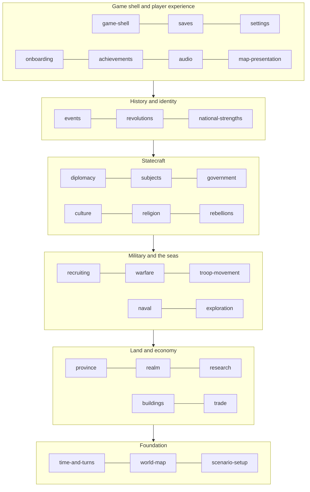

# Pocket Hegemony: context map

Pocket Hegemony is split into 29 bounded contexts. Each one owns a part of the game's rules and its own words for them. This page shows how the contexts fit together and where the seams between them sit. The full detail is in two generated files:

- [context-map-seams.md](context-map-seams.md): every pair of contexts, with what each side says crosses between them (303 pairs).
- [open-questions.md](open-questions.md): every gap and contradiction the specs found (about 550).

The rules for writing a spec and a feature file are in [CONVENTIONS.md](CONVENTIONS.md).

## 1. The contexts in layers

Contexts in a lower layer never depend on a higher one. A higher layer reads a lower one, and the lower one tells it what happened through domain events.

| Layer | Contexts | What the layer is |
|---|---|---|
| Foundation | time-and-turns, world-map, scenario-setup | The clock and turn order, the map and its graph, the 1444 start. Every other context conforms to these. |
| Land and economy | province, realm, research, buildings, trade | People, tiles, food, gold, inventions, buildings and traders. The core domain: almost everything else reads these numbers. |
| Military and the seas | recruiting, warfare, troop-movement, naval, exploration | Raising, moving, feeding and fighting with armies and fleets, and sailing into the unknown. |
| Statecraft | diplomacy, subjects, government, culture, religion, rebellions | How realms treat each other, how they are ruled, who lives in them, and what happens when people rise. |
| History and identity | events, revolutions, national-strengths | The historical layer: events with choices, revolutions that change how a country plays, and each country's heritage. |
| Shell and player experience | game-shell, saves, settings, onboarding, achievements, audio, map-presentation | Everything around and on top of the simulation. None of these may change the simulation's results. |

## 2. Shared kernels

Three things are shared by several contexts and must be built once.

1. **The mover** (troop-movement, naval, trade, exploration). Armies, fleets, traders and exploration ships move with one model: a route planned over one graph, walked in a day loop inside the month, with each kind adding its own "may enter", "stops at" and step-days rules. Troop-movement owns the day loop and planner; the others plug in.
2. **The people mix of a province** (province, culture, religion). A province holds its classes, its tongue mix and its faith mix side by side. Culture and religion change their own mix with the same "pull toward a target each year" shape; province owns the people they belong to.
3. **The levy's people** (recruiting, naval). The sailor muster reuses recruiting's levy shares and commissioning of officials.

## 3. The main flows

| Flow | Path through the contexts |
|---|---|
| A month passes | time-and-turns opens the turn, applies orders, runs the day loop (troop-movement, naval, trade, warfare battles), then monthly steps (province, buildings, recruiting, realm, research, subjects, rebellions, revolutions), seasonal and yearly steps (culture, religion, diplomacy fades), then events, then achievements last. The exact global order is not designed yet (OQ-TIME-2). |
| Gold | province (tax) and trade (deposits, fees, tolls) → realm treasury → spent by buildings, recruiting, research, diplomacy (gifts), naval (ships), exploration (colonies). |
| Food | province tiles and harvests → realm stores and food policy → recruiting and warfare (rations, foraging along troop-movement's routes). |
| People | province classes → recruiting (levy by class shares) → warfare (Fallen go back to province) ; culture and religion change who the people are; rebellions draw rebels from them. |
| War | diplomacy (war aims, declaration, calls to arms) → warfare (battles, sieges, occupation) → diplomacy (peace terms, truce) → subjects or province (land changes hands). |
| Rule | government (forms, caps on officials and lords) → realm (lords, loyalty) and province (officials) ; subjects (reach) ; revolutions (regimes set forms). |
| History | events read stats from every context through an anti-corruption mapping (province §15, country stats §11, trade §12, government's 16 values) and act through a fixed list of effects. Religion, revolutions, culture, subjects, diplomacy and national strengths have asked for new effects; none are merged yet (OQ-EVT-11). |
| Feedback to the player | every context publishes domain events → game-shell (turn report, Needs attention), audio (stingers and music mood), achievements (tests run last), map-presentation (lenses). |

## 4. Seam patterns used

| Pattern | Where | Why |
|---|---|---|
| Conformist | Everyone → time-and-turns, world-map, research ids | The clock, the map and the invention ids are fixed facts the others accept as they are. |
| Customer–Supplier | Most economy and military seams | The downstream context needs specific numbers and has asked for them (the "Changes needed in other files" sections). |
| Partnership | province ↔ warfare, warfare ↔ troop-movement, diplomacy ↔ warfare, realm ↔ subjects, culture ↔ religion | Both sides change together; neither can be designed alone. |
| Published Language | events, achievement moments, everything → map-presentation, game-shell and audio | A shared vocabulary of ids and events that any context can read. |
| Anti-Corruption Layer | events ↔ province, realm, trade, government; national-strengths ↔ scenario-setup | The event tree's own stat names (prosperity, unrest, trade_power …) are translated into each context's model rather than leaking in. |
| Open Host Service | world-map → movement, naval, trade; buildings → religion, national strengths | One stable interface many contexts call. |

## 5. Seams that need a decision first

The specs found that many seams are agreed by one side only: a design asked another to change, and the other design has not taken the change in yet. These are the seams with the most impact. Each line names the open questions that hold it.

1. **When a battle stops the turn** (time-and-turns, warfare, troop-movement, game-shell): three designs disagree. OQ-TIME-3, OQ-WAR-2, OQ-SHELL-2, OQ-MOVE-8.
2. **The order systems run in a turn** (time-and-turns and everyone): no design exists. OQ-TIME-2, OQ-TIME-4 (weekly vs monthly food), OQ-TIME-5 (seasons, harvest month).
3. **The start date** (time-and-turns, scenario-setup, onboarding): March 1444 in the engine, April in the tutorial, 11 November 1444 in the catalogue and relations. OQ-TIME-1, OQ-SETUP-4.
4. **Trade v2 replacing province §7** (trade, province, realm, buildings, national-strengths, research): the old market, merchants and trade balance are still used by four other designs. OQ-TRADE-7, OQ-PROV-1, OQ-REALM-1, OQ-BLD-2, OQ-HER-4, OQ-RSCH-4.
5. **Recruiting v3 not adopted by warfare, province and realm** (commander origins, levy then train, the muster master). OQ-RECR-4/5/6, OQ-WAR-6, OQ-PROV-5.
6. **Subject kinds** (subjects, diplomacy, country-relations data): six kinds in the subjects design, eight in relation-rules.json, with different war rules. OQ-SUBJ-1/2/3, OQ-DIPL-10, OQ-DIPL-33.
7. **How rebels form** (province, rebellions, revolutions): "a share of recruits each month" vs "a 5/15/30 % monthly roll". OQ-REBL-1, OQ-PROV-2, OQ-REVO-3.
8. **Funding rebels and revolutions** (diplomacy, revolutions): designed twice with different numbers. OQ-REVO-1, OQ-DIPL-23.
9. **Truce length** (diplomacy, warfare, relations data, engine): 5 (+5) years, 10 years, 60 months. OQ-DIPL-3.
10. **How a campaign is won** (realm, game-shell, achievements): decided in outline, not designed. OQ-SHELL-1, OQ-REALM-6.
11. **Catalogue against the map** (scenario-setup, every country-level context): 137 map nations vs 963 catalogue records, 37 ids that differ. OQ-SETUP-1, OQ-SETUP-2.
12. **Out-of-scope content after 1939** (events, research, warfare): still present in the data. OQ-EVT-1, OQ-RSCH-1, OQ-WAR-12.
13. **Settings that might change the simulation** (settings, time-and-turns): battery saver's smaller AI budget. OQ-SET-1, OQ-VIEW-9.
14. **Save header flags** (saves, achievements, onboarding): ironman_unbroken, cheat_marked, switched_country and "began as the tutorial" are asked for but not designed. OQ-SAVE-1, OQ-ACH-4, OQ-TUT-6.

## 6. Contexts the designs do not cover yet

These appear as seams or open questions but have no design document and so no context of their own yet:

- **The AI as a whole** (gap list item 18). Each spec has an AI section with what its design says; there is no shared AI design, difficulty levels or per-turn computing budget.
- **Big institutions**: the Empire, the Church, leagues and the tributary system (gap list item 8). Scenario-setup has 16 collective institution records with no rules (OQ-SETUP-8).
- **Modern politics and industry, 1789–1939** (gap list items 12–13), beyond what revolutions and the research tree cover.
- **Disasters and epidemics** (gap list item 19), beyond plague as a province stat.
- **Store, purchases and the free tier** beyond what game-shell and saves say.

## 7. How the specs stay true

`packages/specs` in the game repository runs every feature file under Vitest on each CI run. A scenario whose steps all have a step definition runs and must pass; the rest show as "todo". `pnpm --filter @ph/specs report` prints, per context, how many scenarios are written, automated and passing, and which requirements have a passing scenario. That table is the feedback loop: it shows how much of each context the game actually does, and it fails the build when code and spec disagree.
