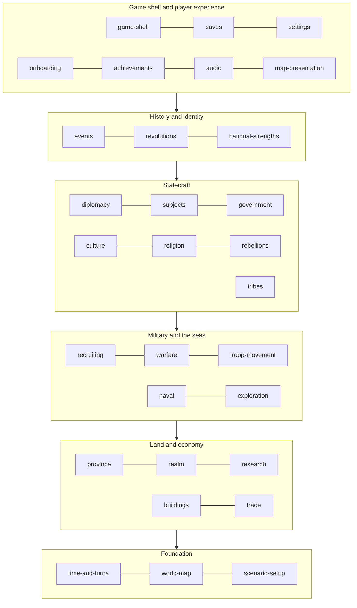

# Pocket Hegemony: context map

Pocket Hegemony is split into 30 bounded contexts. Each one owns a part of the game's rules and its own words for them. This page shows how the contexts fit together and where the seams between them sit. The full detail is in two generated files:

- [context-map-seams.md](context-map-seams.md): every pair of contexts, with what each side says crosses between them (303 pairs).
- [open-questions.md](open-questions.md): every gap and contradiction the specs found, and how each was decided.
- [DECISIONS.md](DECISIONS.md): the decisions that cross several contexts, and the rules used to decide.

The rules for writing a spec and a feature file are in [CONVENTIONS.md](CONVENTIONS.md).

## 1. The contexts in layers

Contexts in a lower layer never depend on a higher one. A higher layer reads a lower one, and the lower one tells it what happened through domain events.

| Layer | Contexts | What the layer is |
|---|---|---|
| Foundation | time-and-turns, world-map, scenario-setup | The clock and turn order, the map and its graph, the 1444 start. Every other context conforms to these. |
| Land and economy | province, realm, research, buildings, trade | People, tiles, food, gold, inventions, buildings and traders. The core domain: almost everything else reads these numbers. |
| Military and the seas | recruiting, warfare, troop-movement, naval, exploration | Raising, moving, feeding and fighting with armies and fleets, and sailing into the unknown. |
| Statecraft | diplomacy, subjects, government, culture, religion, rebellions, tribes | How realms treat each other, how they are ruled, who lives in them, and what happens when people rise. |
| History and identity | events, revolutions, national-strengths | The historical layer: events with choices, revolutions that change how a country plays, and each country's heritage. |
| Shell and player experience | game-shell, saves, settings, onboarding, achievements, audio, map-presentation | Everything around and on top of the simulation. None of these may change the simulation's results. |
| Tooling (outside the game) | balance | The balance model: plays the game headless with AI and probe strategies, reads every layer, and checks that no strategy or mechanic dominates (X-21). It never runs in the game and nothing depends on it. |

## 2. Shared kernels

Three things are shared by several contexts and must be built once.

1. **The mover** (troop-movement, naval, trade, exploration). Armies, fleets, traders and exploration ships move with one model: a route planned over one graph, walked in a day loop inside the month, with each kind adding its own "may enter", "stops at" and step-days rules. Troop-movement owns the day loop and planner; the others plug in.
2. **The people mix of a province** (province, culture, religion). A province holds its classes, its tongue mix and its faith mix side by side. Culture and religion change their own mix with the same "pull toward a target each year" shape; province owns the people they belong to.
3. **The levy's people** (recruiting, naval). The sailor muster reuses recruiting's levy shares and commissioning of officials.

## 3. The main flows

| Flow | Path through the contexts |
|---|---|
| A month passes | time-and-turns opens the turn, applies orders, runs the day loop (troop-movement, naval, trade, warfare battles), then monthly steps (province, buildings, recruiting, realm, research, subjects, rebellions, revolutions), seasonal and yearly steps (culture, religion, diplomacy fades), then events, then achievements last. The full order is decision X-2 in [DECISIONS.md](DECISIONS.md). |
| Gold | province (tax) and trade (deposits, fees, tolls) → realm treasury → spent by buildings, recruiting, research, diplomacy (gifts), naval (ships), exploration (colonies). |
| Food | province tiles and harvests → realm stores and food policy → recruiting and warfare (rations, foraging along troop-movement's routes). |
| People | province classes → recruiting (levy by class shares) → warfare (Fallen go back to province) ; culture and religion change who the people are; rebellions draw rebels from them. |
| War | diplomacy (war aims, declaration, calls to arms) → warfare (battles, sieges, occupation) → diplomacy (peace terms, truce) → subjects or province (land changes hands). |
| Rule | government (forms, caps on officials and lords) → realm (lords, loyalty) and province (officials) ; subjects (reach) ; revolutions (regimes set forms). |
| History | events read stats from every context through an anti-corruption mapping (province §15, country stats §11, trade §12, government's 16 values) and act through a fixed list of effects. Religion, revolutions, culture, subjects, diplomacy and national strengths asked for new effects; events §13 records which were adopted. |
| Feedback to the player | every context publishes domain events → game-shell (turn report, Needs attention), audio (stingers and music mood), achievements (tests run last), map-presentation (lenses). |

## 4. Seam patterns used

| Pattern | Where | Why |
|---|---|---|
| Conformist | Everyone → time-and-turns, world-map, research ids | The clock, the map and the invention ids are fixed facts the others accept as they are. |
| Customer–Supplier | Most economy and military seams | The downstream context needs specific numbers and has asked for them (the "Changes needed in other files" sections). |
| Partnership | province ↔ warfare, warfare ↔ troop-movement, diplomacy ↔ warfare, realm ↔ subjects, culture ↔ religion | Both sides change together; neither can be designed alone. |
| Published Language | events, achievement moments, everything → map-presentation, game-shell and audio | A shared vocabulary of ids and events that any context can read. |
| Anti-Corruption Layer | events ↔ province, realm, trade, government; national-strengths ↔ scenario-setup | The event tree's own stat names (prosperity, unrest, trade_power …) are translated into each context's model rather than leaking in. |
| Open Host Service | world-map → movement, naval, trade; buildings → religion, national strengths | One stable interface many contexts call. |

## 5. Seams that needed a decision first

The specs found that many seams were agreed by one side only: a design asked another to change, and the other design had not taken the change in yet. On 17 October these were decided in the spirit of the gameplay built so far. The full text is in [DECISIONS.md](DECISIONS.md).

| Seam | Contexts | Decision |
|---|---|---|
| When a battle stops the turn | time-and-turns, warfare, troop-movement, game-shell | X-1: battles happen on their day; a player battle stops the turn on the before-the-battle card |
| The order systems run in a turn | time-and-turns and everyone | X-2, X-3, X-4: orders, day loop, monthly, seasonal, yearly, events, achievements, autosave |
| The start date | time-and-turns, scenario-setup, onboarding | X-5: 11 November 1444 for every campaign |
| Trade v2 replacing province §7 | trade, province, realm, buildings, national-strengths, research | X-6: province §7 dropped; levers mapped onto trade ratio gain |
| Recruiting v3 | recruiting, warfare, province, realm | X-7: recruiting v3 everywhere |
| Subject kinds | subjects, diplomacy, scenario-setup | X-8: the subjects design's six kinds |
| How rebels form | province, rebellions, revolutions | X-9: the rebellions design's monthly chance to rise |
| Funding rebels and revolutions | diplomacy, revolutions | X-10: one action with revolutions' numbers |
| Truce length | diplomacy, warfare | X-11: 5 years, +5 if land moved or a subject was made |
| How a campaign is won | realm, game-shell, achievements | X-12: world domination, or best score at the end date |
| Catalogue against the map | scenario-setup and every country-level context | X-13: the map's nations are the realms |
| Content after 1939 | events, research, warfare | X-14: nothing after 31 August 1939 |
| Settings that might change the simulation | settings, time-and-turns | X-15: settings never change results |
| Save header flags | saves, achievements, onboarding | X-16: four new header flags |

## 6. Contexts the designs do not cover yet

These appear as seams or open questions but have no design document and so no context of their own yet:

- **The AI as a whole** (gap list item 18). Each spec has an AI section with what its design says; there is no shared AI design, difficulty levels or per-turn computing budget.
- **Big institutions**: the Empire, the Church, leagues and the tributary system (gap list item 8). Scenario-setup keeps its 16 collective institution records as reference data unless a map nation matches one (D-SETUP-8).
- **Modern politics and industry, 1789–1939** (gap list items 12–13), beyond what revolutions and the research tree cover.
- **Disasters and epidemics** (gap list item 19), beyond plague as a province stat.
- **Store, purchases and the free tier** beyond what game-shell and saves say.

## 7. How the specs stay true

`packages/specs` in the game repository runs every feature file under Vitest on each CI run. A scenario whose steps all have a step definition runs and must pass; the rest show as "todo". `pnpm --filter @ph/specs report` prints, per context, how many scenarios are written, automated and passing, and which requirements have a passing scenario. That table is the feedback loop: it shows how much of each context the game actually does, and it fails the build when code and spec disagree.
